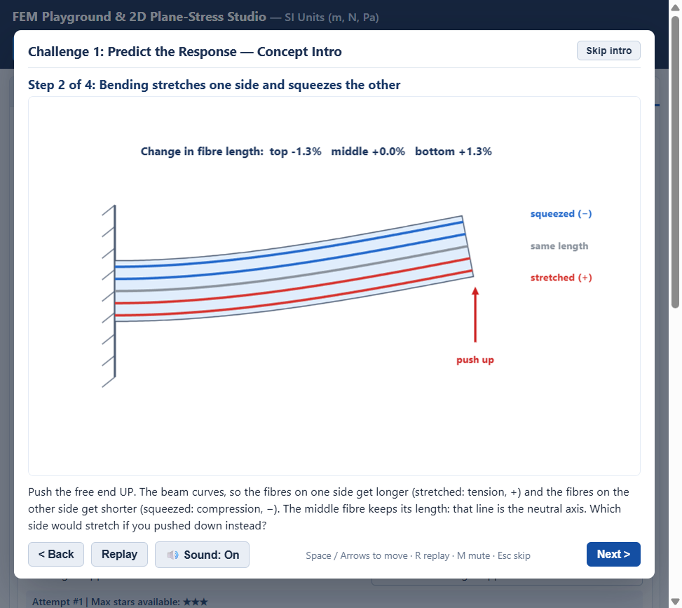
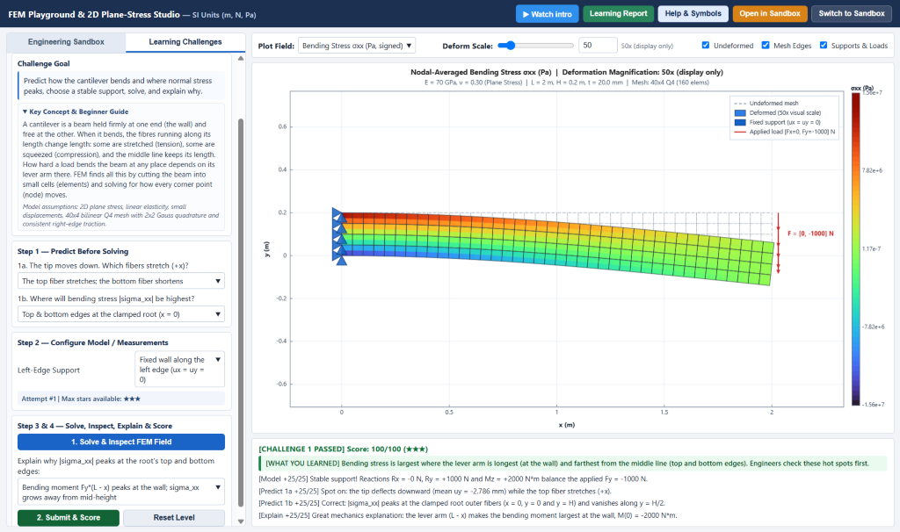
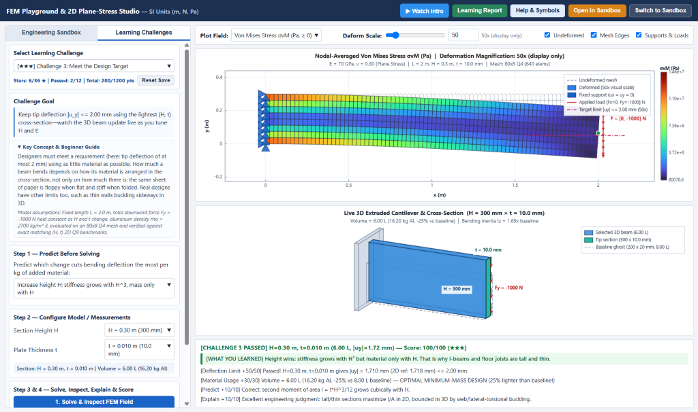
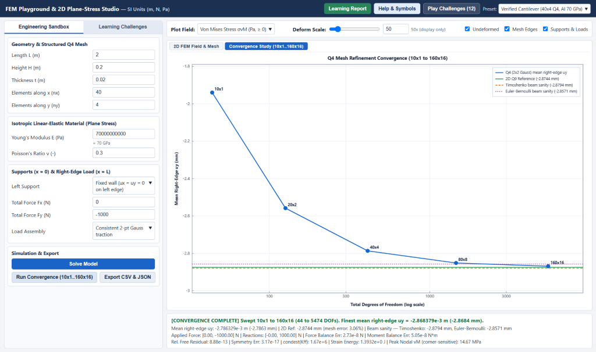

# FEM Playground — Interactive Finite Element Analysis Learning Game

> **Learn finite element analysis by predicting how a structure behaves, building the model, solving a real 2D plane-stress Q4 solver in real time, inspecting displacements and stresses, and explaining the mechanics.**

### [**▶ Play FEM Playground Live in Your Browser**](https://fbrandao2k.github.io/fem-playground/)

*(Runs 100% client-side in any modern desktop or tablet browser — no installation or account required. Progress saves automatically in your browser.)*

---

## Visual Tour

| Concept Intro Animations (with Ambient Music) | Predict → Solve → Inspect → Explain Loop |
| :---: | :---: |
|  |  |
| *Every challenge opens with a short learner-paced visual animation on a nearby physical analog.* | *Predictions lock when you solve; smooth `turbo` contours and coaching guide each retry.* |

| Interactive Auxiliary Mechanics Views | Engineering Sandbox & Mesh Convergence |
| :---: | :---: |
|  |  |
| *Live 3D beam previews, free-body diagrams, `12×12` stiffness assembly maps, and stress probes.* | *Open-ended exploration, `10×1`–`160×16` convergence sweeps, and `CSV` / `JSON` export.* |

---

## Why FEM Playground?

Finite element software makes it easy to generate colorful stress contours without understanding whether the boundary conditions, units, mesh density, or singularities make physical sense. **FEM Playground** turns FEA fundamentals into an interactive 12-challenge engineering campaign (`1,200` points, `36 ★`):

1. **Watch the Concept Intro:** Each challenge begins with a concise, learner-paced animation (paired with calm procedural music) illustrating the core mechanics idea on a nearby example — without giving away the answer.
2. **Step 1 — Predict Before Solving:** Commit to a physical prediction *before* looking at the finite element result (predictions lock as soon as you click **Solve**).
3. **Step 2 & 3 — Configure, Solve & Inspect:** Tune supports, mesh density, cross-sections, constitutive properties, tractions, or element connectivity, and inspect the live 2D `Q4` solution alongside dedicated mechanics charts and hand-calculation checks (`M·c/I`, `V·Q/(I·t)`, `ΣF = 0`, `ΣM = 0`).
4. **Step 4 — Explain & Master:** Connect the numerical result back to the underlying physics, review your 4-chapter **Learning Report**, or click **Open in Sandbox** on any challenge to explore further.

---

## 4-Chapter, 12-Challenge Curriculum

| Chapter | Challenge | Core Mechanics & FEA Concepts |
| :--- | :--- | :--- |
| **I. Build a Faithful Physical Model** | **1. Predict the Response** | Bending tension/compression fibers, lever arm `Fy·(L − x)`, and 2D support stability |
| | **10. Restraint Rescue** | Planar rigid-body modes (`3` DOFs), concurrent/parallel line-of-action traps, and roller vs. pin thrust |
| | **5. Follow the Forces** | Free-body diagrams, reaction forces & moments (`ΣFx = 0`, `ΣFy = 0`, `ΣMz = 0`) vs. solver reactions |
| | **6. Load Detective** | `kN`-vs-`N` unit audits, total force `[N]` vs. line load `[N/m]` vs. shear traction `[Pa]`, and linear scaling |
| **II. Material & Stress Response** | **4. Material Lab** | Inverse-modulus scaling (`u ∝ 1/E`), stiffness vs. strength, and Poisson contraction (`εy = −ν·εx`) |
| | **7. Read the Results** | Signed normal stress `σxx` vs. unsigned von Mises `σvM`, neutral-axis shear `τxy`, and visual scale invariance |
| **III. Inside the Finite Element Method** | **2. Spend Your Elements** | Mesh refinement convergence, parasitic shear locking in coarse bending `Q4`s, and element aspect ratio |
| | **8. Mesh Repair** | Counter-clockwise corner winding, isoparametric Jacobian validity (`det J > 0`), and skew distortion |
| | **11. Inside FEM** | Nodal DOFs, element connectivity stitching, shared-seam stiffness addition (`K = K1 + K2`), and reduced `Kff` |
| **IV. Verify & Sign Off Decisions** | **3. Meet the Design Target** | Minimum-mass cross-section sizing (`I = t·H³/12` vs. area `H·t`) with live 3D beam preview |
| | **9. Can You Trust It?** | Multi-mesh audits distinguishing corner/point-load stress singularities from converged engineering stresses |
| | **12. The Engineering Brief** | Capstone sign-off: coupled section sizing, end-traction rescaling, dual limits, and two-mesh verification |

---

## Under the Hood

- **2D Linear-Elastic Plane-Stress Solver:** Four-node bilinear isoparametric quadrilateral (`Q4`) elements with `2×2` Gauss–Legendre quadrature and consistent 1D Gauss boundary traction integration in strict SI units (`m`, `N`, `Pa`).
- **Diagnostics & Kinematics:** Direct skyline Cholesky factorization, `1`-norm condition-number estimation `condest(Kff)`, element Jacobian & skew quality metrics, and `3×3` SVD nullspace analysis for rigid-body mechanisms.
- **Cross-Verified Accuracy:** Verified to `< 10⁻¹⁰` relative agreement against the reference **MATLAB R2026b** implementation across structured meshes (`10×1` to `160×16`), Iron's irregular-quadrilateral patch test, Euler–Bernoulli / Timoshenko beam theory, and `200×20` biquadratic `Q9` continuum benchmarks.

---

## Platform Roadmap

- [x] **Web Browser Edition** — Live at [fbrandao2k.github.io/fem-playground](https://fbrandao2k.github.io/fem-playground/)
- [x] **MATLAB R2026b Desktop Studio** — Reference numerical & App Designer edition
- [ ] **Android App** — Planned mobile/tablet edition for offline study
- [ ] **iOS & Standalone Desktop Editions** — Future cross-platform releases

---

## Origins, Attribution & Feedback

**FEM Playground** was created by **Felipe da Silva Brandão**, modernizing and expanding upon an earlier PUC-Rio Master's MATLAB finite element project developed with Vetle:

- [Original 2018 MATLAB Repository (`Programa-de-Elementos-Finitos---Matlab`)](https://github.com/fbrandao2k/Programa-de-Elementos-Finitos---Matlab)
- [2018 Demonstration Video (YouTube)](https://www.youtube.com/watch?v=-tj6fx5EYvI)

### Feedback & Classroom Use

Are you a **professor, teaching assistant, student, or practicing engineer**? Educators are warmly welcome to use the live web app in mechanics of materials, structural analysis, or finite element courses!

If you spot an edge case, have an idea for a new challenge, or want to share how it worked with your students, please open an [Issue](https://github.com/fbrandao2k/fem-playground/issues) — comments and suggestions are very welcome!
